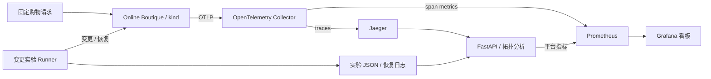

<p align="center">
  
</p>
<h1 align="center">Microservice Observability Platform</h1>
<p align="center"><strong>微服务可观测性与故障实验平台</strong></p>
<p align="center">调用链 · RED 指标 · 拓扑重建 · 受控变更 · 自动恢复</p>

<p align="center">
  <a href="https://github.com/NJNAN/microservice-observability-platform/actions/workflows/ci.yml"></a>
  
  
  <a href="LICENSE"></a>
</p>
<p align="center">
  <a href="#项目亮点">项目亮点</a> · <a href="#验证证据">验证证据</a> · <a href="#快速开始">快速开始</a> · <a href="docs/architecture.md">架构设计</a> · <a href="PROJECT_V1_COMPLETION.md">验收报告</a>
</p>

---

基于 **Kubernetes、OpenTelemetry、Jaeger、Prometheus、Grafana 和 FastAPI**，部署 Google Online Boutique 的十个微服务，沿真实购物请求采集调用链、重建依赖拓扑并观察 RED 指标；通过受控变更验证业务行为，再自动恢复基线并复验。

**让故障实验留下完整证据。** 每次实验保留原始 / 变更 / 恢复三阶段的业务输出、trace 摘要、原始 Jaeger 数据和恢复记录，便于从请求、服务到代码变更逐层定位。

## 项目亮点

| 方向 | 已实现能力 |
| :--- | :--- |
| 部署与联调 | kind/Kubernetes 独立实验集群、源码构建、应用与可观测组件部署、健康检查 |
| 跨语言调用链 | Go、C#/.NET、Node.js、Python、Java tracing，上下文传播与 gRPC client/server 配对验证 |
| 指标与看板 | OpenTelemetry Collector、Prometheus RED 指标、三份版本化 Grafana 看板 |
| 运行时拓扑 | 从 Jaeger span 父子引用重建有向依赖，记录调用次数和 RPC 名称 |
| 变更与恢复 | 18 个受控变更、5 个真实提交的语义重放；串行执行、持久化恢复日志与自动基线回滚 |
| 工程验证 | REST API、回归测试、配置渲染、容器构建；手动触发 kind 冒烟与完整实验流程 |

## 验证证据

| 验证项 | 观察结果 | 对应范围 |
| :--- | :--- | :--- |
| 服务覆盖 | **10/10** | Online Boutique 应用服务 |
| 依赖重建 | **14 条**有向边 | 固定购物请求窗口 |
| gRPC 配对 | **71/71**，无断链 | 业务 client/server span |
| 请求验收 | **5/5** | kind 基线及 C01 原始 / 变更 / 恢复阶段，每阶段分别验收 |

以上是已有干净源码构建后的本地验收记录；本次 README 更新未重跑集群实验。23 个案例具有历史证据，新的 Kubernetes 端到端执行覆盖单独记录。**RCA 准确率、MTTR、延迟提升与 SLO 达成率尚未测量。**

→ [kind 验收原始记录](data/validation/kind-final-gate.json) · [完整验收报告](PROJECT_V1_COMPLETION.md) · [审计与边界](PROJECT_V1_AUDIT.md)

## 系统架构



## 快速开始

Requirements: Python 3.13, Docker with a Linux engine, kubectl, kind v0.27.0 and
registry access. The pinned kind node is Kubernetes v1.32.2. Use an amd64 local
development machine; the cart image build targets linux-x64. Allow sufficient
Docker memory for the application, observability stack and image builds.

```bash
python -m venv .venv
source .venv/bin/activate
make setup
make up
make status
```

Windows PowerShell uses the same Python orchestration:

```powershell
python -m venv .venv
.venv\Scripts\Activate.ps1
python scripts/manage.py setup
python scripts/manage.py up
python scripts/manage.py status
```

`make up` builds traced images, creates the isolated `mop` kind cluster, loads
images, deploys the stack and waits for available Deployments. It fails on any
build/deployment failure. It does not modify existing research Compose containers.
The initial build requires internet access (in restricted networks, provide a
working registry/proxy path for Docker first). A full clean source build — every
image rebuilt without layer cache — plus kind deployment and acceptance gates was
validated on 2026-09-27 (see [data/validation/](data/validation) and the
[completion report](PROJECT_V1_COMPLETION.md)). Locally, previously verified
images can be reused with `python scripts/manage.py up --reuse-local-tracing-images`;
that shortcut is not a clean source-build validation.

In another terminal, keep `make ports` running (Windows: `python scripts/manage.py ports`):

| Component | Local URL |
| --- | --- |
| Storefront | http://localhost:18081 |
| Jaeger | http://localhost:16687 |
| Grafana, anonymous viewer | http://localhost:3000 |
| Prometheus | http://localhost:9090 |
| API / OpenAPI | http://localhost:8000/docs |

## 演示流程

After `make up` and `make ports`:

```bash
# 1. Fixed shopping journey and strict trace gate
make demo
# 2. Inspect Service Overview in Grafana and a frontend trace in Jaeger
# 3. Run original -> price mutation -> restored baseline
make mutation CASE=C01_catalog_price
# 4. Inspect experiment JSON, functional price changes and mutation dashboard
curl http://localhost:8000/api/experiments
curl http://localhost:8000/api/topology
# 5. Verify restoration (normally already automatic)
kubectl --context kind-mop -n mop exec deployment/platform -- python -m obsplatform.cli mutation status
# 6. Re-run the fixed workload against the restored baseline
make demo
```

For an error-focused demonstration use `C03_cart_address` while inspecting
frontend logs and error spans. The [troubleshooting guide](docs/troubleshooting.md)
walks through logs, tcpdump and trace/metric/log correlation. C01 changes business
prices and need not increase error rate. Do not confuse HTTP success with correct
business output.

## 可观测组件

| Component | Purpose |
| --- | --- |
| Collector 0.123.0 | OTLP receiver, Jaeger export, spanmetrics connector |
| Jaeger 1.76.0 | Distributed trace waterfall and evidence source |
| Prometheus 3.2.1 | Server request/error rate, duration histogram, platform metrics |
| Grafana 11.6.0 | Service, distributed-system and failure-experiment dashboards |
| FastAPI | JSON topology and experiments; Prometheus platform endpoint |

Dashboard definitions live in [dashboards](dashboards). The distributed dashboard
links to the topology API; it does not claim an unimplemented Grafana node graph.
Deployment availability and request health are separate signals. RED dashboards
use server spans; client traffic is a separate panel. [Tracing details](docs/tracing.md).

## 故障与变更实验

```bash
python -m obsplatform.cli mutation list
kubectl --context kind-mop -n mop exec deployment/platform -- python -m obsplatform.cli mutation run C01_catalog_price
kubectl --context kind-mop -n mop exec deployment/platform -- python -m obsplatform.cli mutation restore C01_catalog_price
# Longer manual run; stops on first execution/restoration failure
kubectl --context kind-mop -n mop exec deployment/platform -- python -m obsplatform.cli mutation run-all
```

Experiments record original/changed/restored HTTP workloads, trace summaries,
raw Jaeger traces and functional gRPC oracle responses. The five real commit cases
are scoped semantic replays, not full historical repository deployments. All 23
cases had historical evidence; new Kubernetes execution is tracked separately.
See [case catalog](configs/mutations.json) and [restoration/recovery](docs/mutations.md).

## 运行时拓扑

The analyzer follows actual Jaeger span parent references. Example edge format:

```json
{"source": "frontend", "target": "checkoutservice", "calls": 1}
```

Open a `frontend` trace in Jaeger to follow
`frontend → recommendationservice → productcatalogservice`, and the checkout
fan-out to cart, currency, payment, shipping, email and catalog services.
`/api/topology` contains nodes, edges and observed RPCs from the last collected
workload window. Empty data is returned before the first collection.

## 项目结构

```text
obsplatform/          API, topology, telemetry, runner, CLI
k8s/                 application / observability / platform
configs/             Collector, Prometheus, Grafana, case catalog
dashboards/          Three provisioned Grafana JSON dashboards
scripts/             Shared cross-platform orchestration and validation
tests/               API, trace-gate and restoration regression tests
data/validation/     Measured V1 evidence
research/            Index to preserved research evidence
cia_preexperiment_v2/ Preserved upstream source, tracing fixes and case inputs
```

See [architecture](docs/architecture.md) and [audit](PROJECT_V1_AUDIT.md).
The Python module is `obsplatform` to avoid shadowing Python's `platform` module.

## API

| Method | Endpoint |
| --- | --- |
| GET | `/health`, `/metrics` |
| GET | `/api/services`, `/api/topology`, `/api/traces/summary` |
| GET | `/api/mutations`, `/api/experiments`, `/api/experiments/{id}` |
| POST | `/api/mutations/{id}/run`, `/api/mutations/{id}/restore` |

POST operations are synchronous. They run only with `MOP_ALLOW_MUTATIONS=1`,
enabled in the isolated kind lab. No public ingress or production authentication
is provided. Keep the service on localhost through port-forwarding.

## 验证结果与边界

| Evidence | Observed services | Edges | gRPC pairing | Workload |
| --- | --- | --- | --- | --- |
| Historical Compose gate | 10/10 | 14 | 71/71 | 5/5 each run |
| Collector Compose gate | 10/10 | 14 | 71/71 | 5/5 |
| kind baseline, clean source build | 10/10 | 14 | 71/71 | 5/5 |
| kind C01 mutation (original/changed/restored) | 10/10 each | 14 each | 71/71 each | 5/5 each |

RCA accuracy, telemetry reduction, MTTR, latency improvement, availability and
SLO attainment: **Not measured yet**. No performance improvement is claimed.

## 开发与验证

```bash
make test
python scripts/generate.py
kubectl kustomize k8s
docker compose config --quiet
```

Compose remains a development/tracing-debug fallback: build images with
`python scripts/manage.py build`, then `docker compose up -d`, run
`python -m obsplatform.cli demo`, and stop with `docker compose down`.
It has no Kubernetes mutation execution. The original research Compose is unchanged.

CI runs lint, unit tests, configuration validation and the platform image build.
Manual workflow dispatch adds kind smoke or the full mutation suite. GitHub Actions
execution is not claimed until this directory is published and a workflow runs.

For a curated public source tree, run
`python scripts/export_release.py dist/microservice-observability-platform`.
This exports required source/fixtures without nested Git databases, build caches or
unrelated upstream systems. Original research evidence remains untouched. Review
the exported source manifest and initialize Git there for publication.

Export experiment evidence before `make down`; deleting kind removes its PVC.

## 后续计划

Run all 23 mutation scenarios end-to-end on kind; add targeted PR smoke once
runtime/cost is established; improve dashboard evidence and reproducible dependency
locking. Production auth and persistent telemetry storage follow only after the
local engineering demo is stable.
