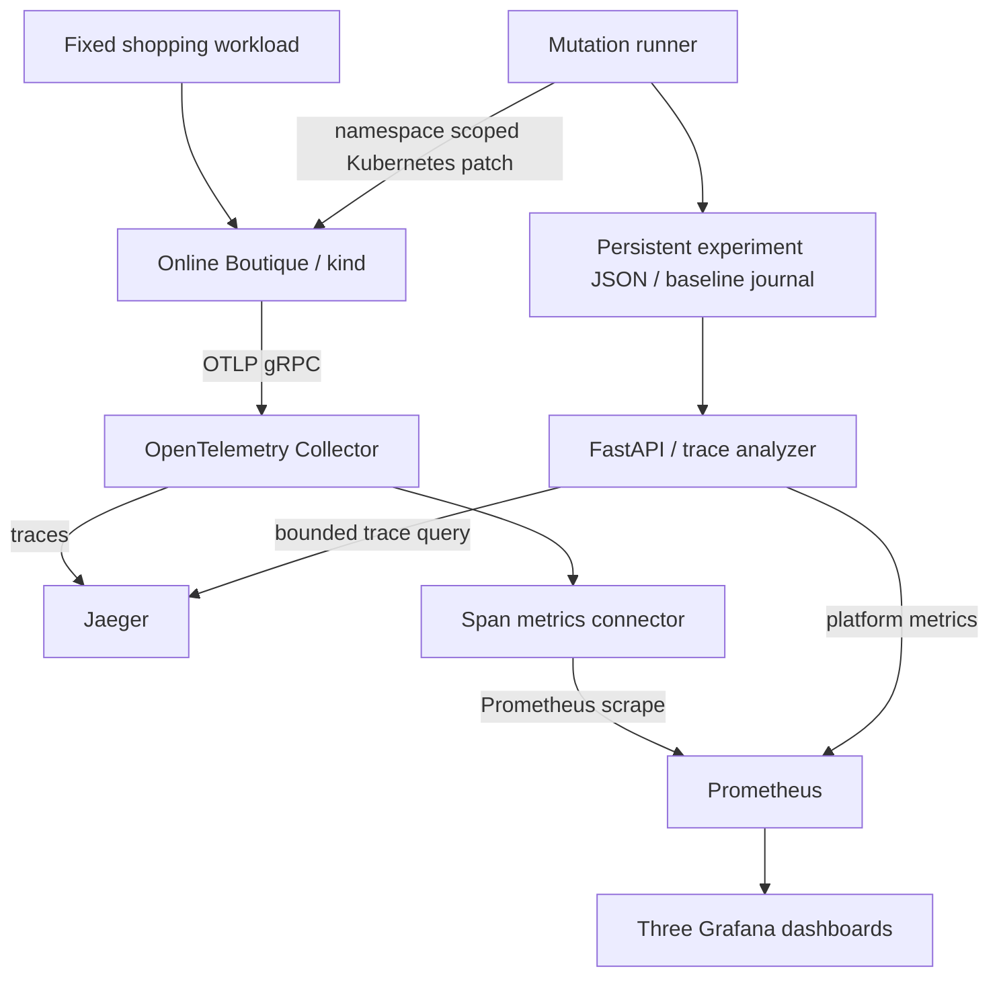

# Architecture

The V1 uses Google Online Boutique v0.10.4: ten application services and Redis.
The upstream Kubernetes release manifests retain their service accounts, security
contexts, resource isolation and probes. `scripts/generate.py` changes images,
OTLP endpoints and the email port to match the previously verified tracing fixes.

Trace reconstruction reads actual parent-child references and server span kinds.
It reports services, directed edges, call counts and observed RPC names. This is
runtime service topology reconstruction, with no inferred root-cause model.

The runner serializes experiments through a filesystem lock on the platform PVC.
Before making any change it saves the full Pod template to an atomic restoration
journal. It collects original and changed workloads and gRPC oracles, replaces the
whole template on exit, waits for rollout and checks a restored workload/trace gate.
A failed restore retains the journal for recovery. Kubernetes restarts are handled
by explicit recovery rather than blindly resuming a partially applied experiment.

The API is one process/one replica; mutation POSTs are synchronous and may take
several minutes. The local lab explicitly enables them. RBAC is namespace scoped.
No public ingress is created; the demo uses localhost port-forwarding. Production
authentication, distributed locking, remote storage and multi-cluster operation are
outside V1. Jaeger and Prometheus use ephemeral lab storage; experiment JSON uses a
PVC but is deleted when the kind cluster is deleted. Export evidence first.

`obsplatform` deliberately avoids Python's standard-library `platform` name.
Research inputs stay at their original paths so provenance and old scripts survive.
